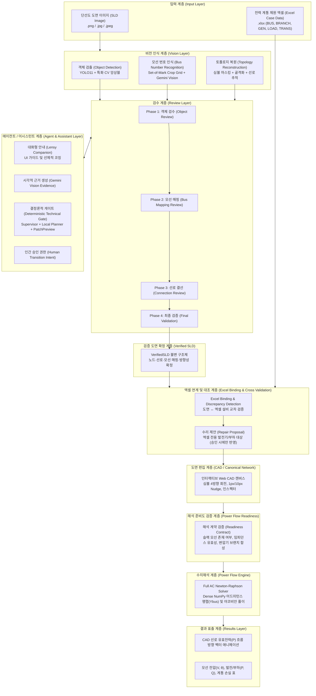
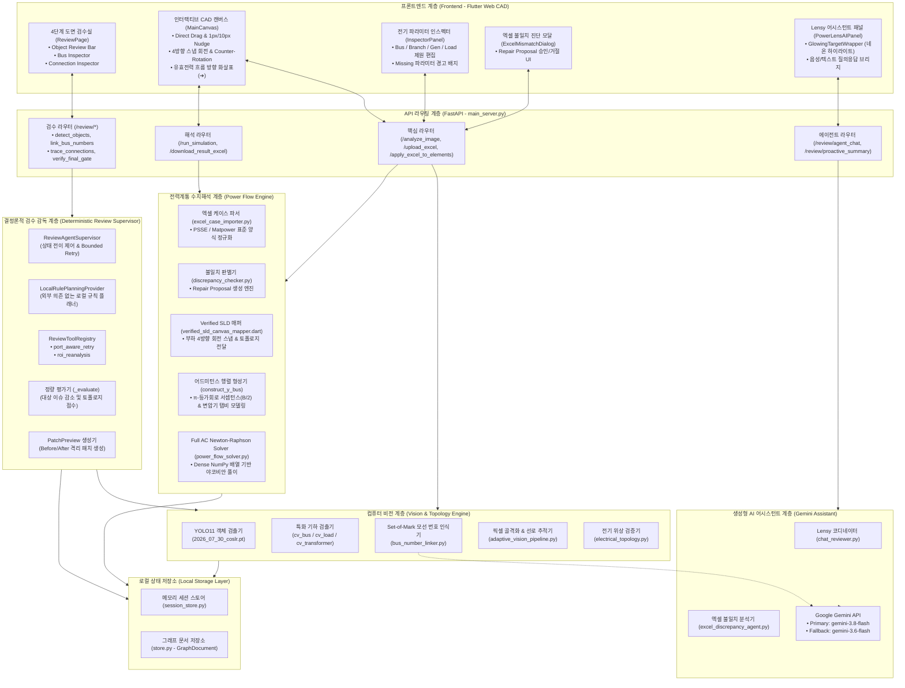

# 🏗️ PowerLens 시스템 구성도 (System Architecture)

> **문서 버전**: v2.0.0 (2026-09-27)  
> **문서 목적**: 제17회 전력산업 소프트웨어 경진대회·AI 경진대회 제출용 시스템 구성도 명세  
> **시스템 정의**: 전력 계통 단선도(Single-Line Diagram, SLD) 이미지의 AI/CV 객체 인식, 4단계 Human-in-the-Loop 검수 게이트, 엑셀 제원 연계 검증 및 Full AC Newton-Raphson 조류계산 통합 플랫폼

---

## 1. 시스템 개념 구성도 (Conceptual Flow)

PowerLens는 비전 인식부터 계통 해석에 이르기까지 **데이터 추출 → 엔지니어 검증 → 제원 대조 → 수치해석**의 단계적 파이프라인으로 구성됩니다.



---

## 2. 전체 시스템 블록 다이어그램 (Detailed Architecture Diagram)



---

## 3. 핵심 역할 분담 원칙 (Architectural Role Clarification)

PowerLens는 생성형 AI가 임의로 전력망 데이터를 변경하거나 워크플로를 독단적으로 제어하지 않도록, **4개의 상호 독립된 역할**을 엄격히 규정합니다.

```
┌─────────────────────────────────────────────────────────────┐
│ 1. Gemini / Vision = Evidence Generation (증거 생성)        │
│    • 모선 번호 크롭 판독 및 시각적 OCR 후보 추출             │
│    • 도면-엑셀 제원 간 불일치 원인 자연어 설명 생성          │
│    • 최종 진위 판정 권한 없음 (증거 데이터만 제공)          │
├─────────────────────────────────────────────────────────────┤
│ 2. Lensy = Conversational Assistant & Guidance (대화형 안내) │
│    • 사용자 질의응답 및 다음 검수 단계 추천                 │
│    • 질문 의도에 따른 25개 UI 버튼 네온 점등 (시각적 유도)   │
│    • 독단적인 캔버스 수정 및 단계 강제 전이 불가             │
├─────────────────────────────────────────────────────────────┤
│ 3. Deterministic Gate = Technical Validation (공학적 검증)  │
│    • 토폴로지 고립, 단선, 이상 임피던스, 복회선 규칙 검증    │
│    • 로컬 규칙 플래너 및 패치 프리뷰(PatchPreview) 생성      │
│    • 결함 잔존 시 다음 단계로의 진입 차단 (Gatekeeper)       │
├─────────────────────────────────────────────────────────────┤
│ 4. Human = Review & Explicit Transition Intent (최종 승인)  │
│    • 의심 객체 수동 확인, 모선 번호 최종 검수               │
│    • 수리 제안(Repair Proposal)의 명시적 Apply / Reject     │
│    • 다음 검수 단계 및 조류계산 실행에 대한 배타적 결정권     │
└─────────────────────────────────────────────────────────────┘
```

---

## 4. 데이터 흐름 및 저장 메커니즘 (Data Flow & Storage)

1. **GraphDocument**:
   - `backend_api/review/schemas.py`에 정의된 Pydantic 모델.
   - 단선도 이미지 내 모든 노드(`GraphNode`), 선로(`GraphEdge`), 접속 포트(`Port`), 검출된 결함(`ReviewIssue`)을 불변 식별자(UUID5) 기반으로 버전 관리.
2. **VerifiedSLD**:
   - 4단계 검수 게이트를 통과한 후 확정되는 불변 JSON 스키마.
   - 기하 좌표, 검증된 모선 번호, 장치 결선 정보, 방향성 메타데이터를 포함하여 Web CAD 캔버스로 안전하게 전달.
3. **Canonical Network**:
   - `DrawingElement` 구조체 배열.
   - 캔버스 렌더링, 엑셀 제원 바인딩, 슬랙/PV/PQ 모선 속성 부여, 조류계산 입력 데이터로 사용.
4. **Local In-Memory Persistence**:
   - 외부 클라우드 데이터베이스에 의존하지 않고, 백엔드 프로세스 메모리 기반 `session_store.py` 및 파일 시스템 기반 캐시로 격리 관리.
