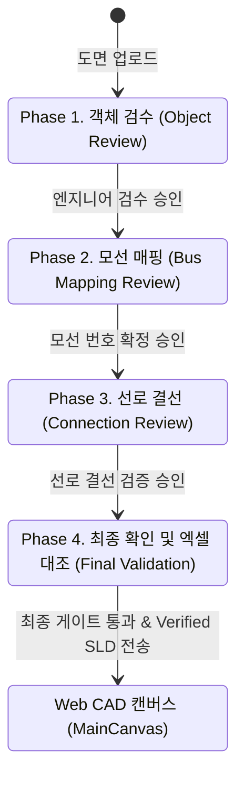
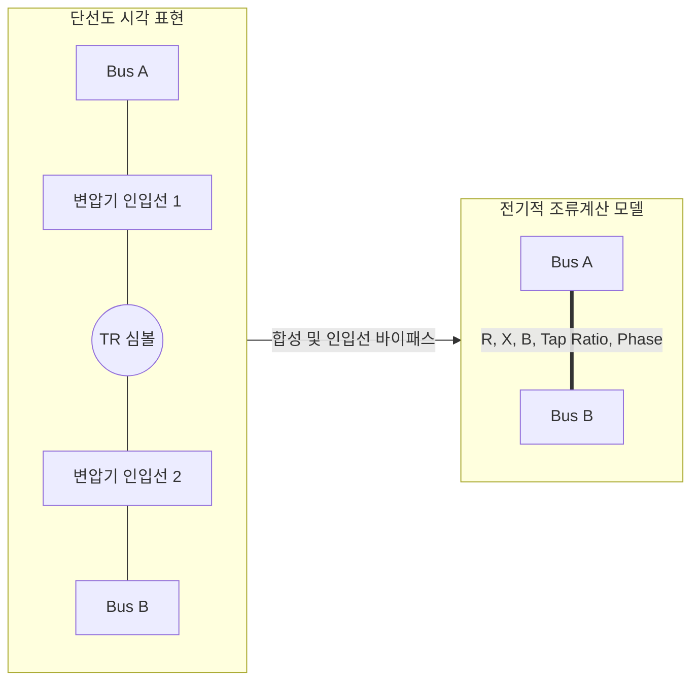

# 📐 PowerLens 상세 기술 문서 (Technical Documentation)

> **문서 버전**: v2.0.0 (2026-09-27)  
> **문서 목적**: 제17회 전력산업 소프트웨어 경진대회·AI 경진대회 제출용 상세 기술 명세서  
> **기준 코드베이스**: `backend_api/` (Python 3.11, FastAPI, PyTorch/YOLO11, NumPy, OpenCV), `frontend_app/` (Flutter 3.19+ Web)

---

## 1. System Overview (시스템 개요)

전력 계통 해석(Power System Analysis)을 위한 전산망 데이터를 구축할 때, 도면(Single-Line Diagram)을 육안으로 확인하며 수십~수백 개의 모선 번호, 송전선로 임피던스, 발전기 및 부하 제원을 수작업으로 전산 툴에 타이핑하는 과정은 장시간이 소요되며 인적 입력 오류(Human Error)가 빈번하게 발생합니다.

**PowerLens**는 이러한 문제를 해결하기 위해 개발된 **단선도 AI 인식, 4단계 검수 게이트, 엑셀 제원 교차 검증 및 Full AC Newton-Raphson 조류계산 원스톱 솔루션**입니다.

### 핵심 동작 원칙
1. **증거 기반 비전 인식**: 딥러닝(YOLO11)과 기하학적 OpenCV 알고리즘의 상호 보완을 통해 심볼과 선로를 검출하고, Set-of-Mark 기법으로 모선 번호를 판독합니다.
2. **Human-in-the-Loop 검수 체계**: 100% 자동 인식이 가질 수 있는 오탐 위험을 방어하기 위해 객체 검수 → 모선 매핑 → 선로 결선 → 엑셀 대조의 4단계 검수 게이트(Review Gate)를 제공합니다.
3. **엄밀한 수치해석 구현**: 엑셀 제원을 Source of Truth로 삼아 임의의 기본값(Fallback) 주입을 원천 배제하고, 복소 어드미턴스 행렬($Y_{\text{bus}}$)과 야코비안(Jacobian) 선형 방정식을 풀이하는 자체 Full AC Newton-Raphson 솔버를 탑재했습니다.

---

## 2. Technology Stack (기술 스택)

| 계층 | 기술 요소 | 버전 / 명세 | 역할 및 활용 목적 |
| :--- | :--- | :--- | :--- |
| **프론트엔드** | Flutter Web | 3.19+ / Dart 3.3+ | 인터랙티브 웹 CAD 캔버스, 검수실 화면, 반응형 AI 어시스턴트 UI |
| **백엔드 프레임워크**| FastAPI | 0.100+ / Uvicorn | 비동기 REST API 게이트웨이, 검수 세션 및 라우팅 |
| **프로그래밍 언어**| Python | 3.11+ | 백엔드 비전 파이프라인, 에이전트 감독자, 조류계산 엔진 |
| **딥러닝 객체 검출**| Ultralytics YOLO11 | PyTorch 기반 / 커스텀 학습 | 단선도 심볼(모선, 발전기, 부하, 변압기) 1차 바운딩 박스 제안 |
| **컴퓨터 비전 / 기하**| OpenCV (headless) | 4.8+ / NumPy | 적응형 이진화, 형태학적 연산, Zhang-Suen 픽셀 골격화, 선로 추적 |
| **시각적 AI 모델** | Google Gemini API | gemini-3.8-flash (fallback: 3.6) | Set-of-Mark 모선 번호 OCR 판독, 엑셀 불일치 분석 및 질의응답 |
| **수치해석 / 선형대수**| NumPy | 1.24+ (Dense 2D Arrays) | 복소 어드미턴스 행렬($Y_{\text{bus}}$) 및 야코비안 행렬 방정식 풀이 (`linalg.solve`) |
| **데이터 처리** | openpyxl / pandas | 3.1+ | PSSE 및 Matpower 표준 엑셀 시트 파싱 및 정규화 |

---

## 3. Vision Pipeline (비전 파이프라인)

[`backend_api/core/vision_logic.py`](file:///c:/Users/dptjd/Downloads/PowerLens/backend_api/core/vision_logic.py) 및 [`adaptive_vision_pipeline.py`](file:///c:/Users/dptjd/Downloads/PowerLens/backend_api/core/adaptive_vision_pipeline.py)에 구현된 비전 파이프라인은 래스터 이미지로부터 심볼, 선로, 모선 번호를 정밀 추출합니다.

### 3.1 Object Detection (객체 검출)
- **체크포인트**: `backend_api/models/2026_07_30_coslr.pt` (Cosine Annealing LR 스케줄러 적용).
- **클래스별 신뢰도 임계치**:
  - `bus`: 0.30
  - `generator`: 0.30
  - `load`: 0.27
  - `transformer`: 0.50
  - 입력 이미지 크기: 640px 적응형 리사이즈, 프로브 임계치: 0.05

### 3.2 Bus Detection (모선 기하 검출 및 복원)
- [`backend_api/core/cv_bus_detector.py`](file:///c:/Users/dptjd/Downloads/PowerLens/backend_api/core/cv_bus_detector.py): 도면의 긴 직사각형 획 및 두꺼운 직선의 윤곽선을 분석.
- **Relaxed Rescue**: YOLO 신뢰도가 임계치보다 낮더라도, CV 기하 검출기가 추출한 직사각형 영역과 IoU가 일정 수준 이상 정합되면 모선 후보로 복원하여 오탐 및 미탐을 동시 방어합니다.

### 3.3 Bus Number Recognition (모선 번호 판독)
- [`backend_api/core/bus_number_linker.py`](file:///c:/Users/dptjd/Downloads/PowerLens/backend_api/core/bus_number_linker.py):
  1. 각 모선 바운딩 박스 주변의 텍스트 영역을 국소 크롭.
  2. 크롭 이미지에 시각적 마커(B1, B2, B3...)를 오버레이한 Set-of-Mark(SoM) 콜라주 생성.
  3. Gemini Vision API(`gemini-3.8-flash` 우선, 429 또는 실패 시 `gemini-3.6-flash`로 자동 폴백)에 전달하여 번호 판독 질의.
  4. 중복 번호, 비숫자 형식, 신뢰도 미달 항목은 추측하지 않고 `UNCERTAIN` 상태로 보존하여 엔지니어 수동 검수로 위임.
  5. 검증된 모선 번호는 `propagate_bus_numbers_to_devices`를 통해 직결된 발전기, 부하, 변압기로 일관되게 전파.

### 3.4 Topology Reconstruction (선로 위상 추적)
- **심볼 마스킹**: 검출된 설비 영역을 제외하여 기호 내부 획이 선로로 잘못 인식되는 것을 방지.
- **간극 보정**: `bridge_one_pixel_gaps`를 통해 스캔 노이즈로 인한 1픽셀 미세 단선을 보정.
- **골격화**: Zhang-Suen 씬닝(Thinning) 알고리즘으로 선로를 1픽셀 중심선으로 축소.
- **8-방향 경로 추적**: 분기점과 종단을 탐색하여 송전선로(Transmission Branch), 변압기 가상 리드선(`is_transformer_lead: True`), 설비 인입선(`isEquipmentLead: True`)으로 분류.

---

## 4. Review Architecture (4단계 검수 아키텍처)

[`backend_api/review/staged_api.py`](file:///c:/Users/dptjd/Downloads/PowerLens/backend_api/review/staged_api.py) 및 [`frontend_app/lib/screens/review_page.dart`](file:///c:/Users/dptjd/Downloads/PowerLens/frontend_app/lib/screens/review_page.dart)에서 제공되는 검수 체계는 단계별로 명확한 검증 목표를 갖습니다.

### 4.1 Phase 1: Object Review (객체 검수)
- **역할**: 도면 내 모선, 발전기, 부하, 변압기의 위치(Bounding Box)와 분류(Class) 검증.
- **분류 기준**:
  - `DETECTED` (정상 객체): 2차 검수 임계치(모선 0.60, 발전기 0.55, 부하 0.50, 변압기 0.50) 이상.
  - `SUSPICIOUS` (의심 객체): 신뢰도 미달, 객체 간 중첩(IoU > 0.35), 비정상 종횡비 객체.
- **엔지니어 조작**: 의심 객체 개별 확인, 라벨/클래스 수정, 정상 객체 일괄 승인([정상 객체 승인]).

### 4.2 Phase 2: Bus Mapping (모선 매핑)
- **역할**: 각 모선에 부여된 고유 모선 번호(Bus Number) 및 기기-모선 간 귀속 관계 검증.
- **게이트 조건**: 모든 모선이 양의 정수 번호를 가져야 하며, 중복 번호가 없어야 함. 불확실한 모선은 수동 입력으로 해결.

### 4.3 Phase 3: Connection Review (선로 결선 검수)
- **역할**: 송전선로 양단 모선 연결, 변압기 리드선, 설비 인입선의 물리적 연결 확인.
- **게이트 조건**: 고립 모선(Isolated Bus), 미연결 발전기, 비정상 단자 차수 해소.

### 4.4 Phase 4: Final Validation (최종 검증)
- **역할**: 결정론적 검증 게이트(`verify_final_gate`)를 통한 전 계통 무결성 검사.
- **산출물**: 불변 `VerifiedSLD` JSON 객체 생성.

---

## 5. Lensy / Agentic Assistance (에이전트 및 어시스턴트)

### 5.1 Gemini 역할: Evidence Generation
- 모선 번호 크롭 콜라주 판독, 엑셀 제원과 도면 간의 불일치 원인 분석 설명문 생성.
- 최종 진위 여부를 스스로 확정하지 않고 증거(Evidence)와 분석 텍스트만 시스템에 제공.

### 5.2 Lensy 역할: Conversational Assistant & Guidance
- [`frontend_app/lib/services/powerlens_ai_service.dart`](file:///c:/Users/dptjd/Downloads/PowerLens/frontend_app/lib/services/powerlens_ai_service.dart)를 통해 구동되는 대화형 조수.
- 단계별 검수 가이드 제공 및 사용자 질문 의도에 따른 25개 UI 버튼 네온 점등 (`GlowingTargetWrapper`).
- 사용자가 질문하거나 작업을 요청하면 해당 UI 컴포넌트로 시각적 주의를 유도.

### 5.3 Deterministic Gate: Technical Validation
- [`backend_api/agent/supervisor.py`](file:///c:/Users/dptjd/Downloads/PowerLens/backend_api/agent/supervisor.py)의 `ReviewAgentSupervisor`:
  - 외부 LLM에 의존하지 않는 `LocalRulePlanningProvider`로 최대 2회 순차 계획 수립.
  - 특화 비전 도구(`port_aware_retry`, `roi_reanalysis`) 제한 실행.
  - 가상 diff를 격리 보관하는 `PatchPreview` 생성.
  - 목표 지표 개선 시에만 사용자에게 승인 대기(`AWAITING_APPROVAL`)로 제시.

### 5.4 Human-in-the-Loop 원칙
- AI 에이전트는 결코 스스로 "문제없음"을 판단하여 다음 검수 단계로 자동 전이하지 않습니다.
- **사용자 직접 검수 확인 $\rightarrow$ 명시적 진행 요청 $\rightarrow$ 결정론적 게이트 기술 검증 $\rightarrow$ Blocker 없음 $\rightarrow$ 다음 단계 진행**의 통제 절차를 엄격히 준수합니다.

---

## 6. Verified SLD / Canonical Network (검증 도면 모델)

[`frontend_app/lib/models/verified_sld_canvas_mapper.dart`](file:///c:/Users/dptjd/Downloads/PowerLens/frontend_app/lib/models/verified_sld_canvas_mapper.dart)는 검증된 JSON 스키마를 CAD 캔버스 요소로 안전하게 변환합니다.

1. **상태 불변성 검증**: `status == 'VERIFIED'`가 아니면 CAD 매핑을 즉시 거절.
2. **좌표 중심 정렬**: 도면 원본 Bounding Box 중심을 계산하여 캔버스 중심(`CANVAS_CENTER = 3000.0`)으로 평행이동(`shift = canvasCenter - origCenter`).
3. **부하(Load) 방향 자동 산출**:
   - 명시적 메타데이터(`orientation`, `direction`)가 없을 경우, 연결된 부모 모선과의 상대 기하 위치(`dx`, `dy`)에 따라 4방향 스냅 회전 각도 산출:
     - 수평 모선: 모선 위쪽(`dy < -6`) $\rightarrow$ $\pi$ (UP), 모선 아래쪽(`dy > 6`) $\rightarrow$ $0.0$ (DOWN), 좌/우 $\rightarrow$ $\pi/2$ / $-\pi/2$.
     - 수직 모선: 모선 오른쪽(`dx > 6`) $\rightarrow$ $-\pi/2$ (RIGHT), 모선 왼쪽(`dx < -6`) $\rightarrow$ $\pi/2$ (LEFT), 상/하 $\rightarrow$ $\pi$ / $0.0$.
     - 인입선 경로가 있는 경우 말단 진입 벡터를 보조 계산하여 90도 스냅 회전 확정.

---

## 7. Excel Integration (엑셀 연계 및 교차 검증)

### 7.1 Excel Binding
- [`backend_api/core/excel_case_importer.py`](file:///c:/Users/dptjd/Downloads/PowerLens/backend_api/core/excel_case_importer.py): PSSE 및 Matpower 표준 엑셀 시트(`BUS`, `BRANCH`, `GENERATOR`, `LOAD`, `TRANSFORMER`)를 파싱하여 도면 설비에 전기적 제원을 결합.

### 7.2 Cross Validation & Discrepancy Detection
- [`backend_api/core/discrepancy_checker.py`](file:///c:/Users/dptjd/Downloads/PowerLens/backend_api/core/discrepancy_checker.py): 도면 요소와 엑셀 행 데이터를 비교하여 불일치 항목을 검출:
  - `missing_in_canvas`: 엑셀에는 정의되어 있으나 도면 캔버스에 없는 설비.
  - `missing_in_excel`: 도면에 작도되었으나 엑셀에 파라미터가 없는 설비.

### 7.3 Repair Proposal (수리 제안 정책)
> [!IMPORTANT]
> **수리 제안(Repair Proposal)의 적용 범위는 엄격히 제한됩니다.**
> - **대상 설비**: `missing_in_canvas` 상태의 **발전기(Generator)** 및 **부하(Load)**에 대해서만 생성.
> - **자동 생성 금지 설비**: **모선(Bus), 송전선로(Line), 변압기(Transformer)**는 엑셀을 근거로 자동 생성하지 않음.
> - **도면 전용 설비 보존**: 엑셀에 없다는 이유로 도면에 작도된 설비를 자동 삭제하지 않고 불일치 검토 대상으로 유지.
> - **변경 격리**: 엔지니어가 명시적으로 [Apply]를 누르기 전에는 캔버스와 솔버 입력에 일절 변경을 가하지 않으며, [Reject] 시 원본 도면을 그대로 유지.

---

## 8. Transformer Modeling (변압기 모델링)

단선도 상에서 변압기는 2개의 맞물린 원형 심볼과 주변 리드선으로 표현되지만, 전기 계통 해석에서는 2개 모선 간의 브랜치 어드미턴스로 취급되어야 합니다.

1. **시각적 인입선 바이패스**: 변압기 심볼과 모선을 잇는 가상 선로는 `is_transformer_lead: True` 및 임피던스 $0.0$으로 마킹하여, 조류계산 송전선로에서 제외(Bypass)함으로써 영임피던스 나눗셈($1/Z$) 발산을 방지합니다.
2. **2-Port 전기적 브랜치 합성**: 변압기 심볼에 연결된 모선 쌍을 엑셀 `TRANSFORMER` 시트와 교차 검증하여 `electrical_branches` 목록을 구성합니다.
3. **다중 변압기 브랜치 매핑**: 서브스테이션 내 3권선 또는 다중 변압기 구성 시(예: 24모선 케이스의 9-11, 9-12, 10-11, 10-12, 3-24 총 5개 브랜치), 각 브랜치의 임피던스($R, X, B$)와 오프노미널 탭비($a$) 및 탭 방향(`tapFromBus`)을 정밀하게 어드미턴스 행렬에 스탬핑합니다.

---

## 9. Power Flow Readiness (해석 준비도 검증)

[`frontend_app/lib/models/power_flow_readiness.dart`](file:///c:/Users/dptjd/Downloads/PowerLens/frontend_app/lib/models/power_flow_readiness.dart)는 조류계산 호출 전 계통의 공학적 완성도를 사전 진단합니다.

- **필수 충족 계약 (Readiness Contract)**:
  1. 슬랙 모선(Slack Bus)이 정확히 1개 이상 지정되어 있는가.
  2. 최소 1기 이상의 유효 발전기가 계통에 연결되어 있는가.
  3. 모든 활성 선로에 유효 임피던스($Z \ne 0$)가 부여되어 있는가 (`MISSING` 상태 선로 부재).
  4. 변압기 심볼에 유효한 전기적 브랜치가 바인딩되어 있는가.
- 위 조건 중 하나라도 미충족 시 시뮬레이션 버튼이 비활성화되며 구체적인 미비 항목을 인스펙터에 안내합니다.

---

## 10. Full AC Newton-Raphson Solver (조류계산 엔진)

[`backend_api/core/power_flow_solver.py`](file:///c:/Users/dptjd/Downloads/PowerLens/backend_api/core/power_flow_solver.py)에 구현된 솔버는 전력 계통 해석의 표준 수치해석 기법을 따릅니다.

### 10.1 어드미턴스 행렬 ($Y_{\text{bus}}$) 구성
- 선로 $\pi$-등가 모델 적용:
  $$Y_{ii} = \sum_{k \in \Omega_i} \left( \frac{1}{Z_{ik}} + j\frac{B_{ik}}{2} \right) + Y_{\text{shunt}, i}$$
  $$Y_{ik} = -\frac{1}{Z_{ik}}$$
- 변압기 탭비 $a : 1$ 모델링 ($i$: 탭 측, $k$: 비탭 측):
  $$Y_{ii} = \frac{Y_{T}}{a^2}, \quad Y_{kk} = Y_{T}, \quad Y_{ik} = Y_{ki} = -\frac{Y_{T}}{a}$$

### 10.2 전력 방정식 및 야코비안 연립방정식
각 모선 $i$에서의 계산 유효/무효 전력:
$$P_i = |V_i| \sum_{k=1}^N |V_k| (G_{ik} \cos\theta_{ik} + B_{ik} \sin\theta_{ik})$$
$$Q_i = |V_i| \sum_{k=1}^N |V_k| (G_{ik} \sin\theta_{ik} - B_{ik} \cos\theta_{ik})$$

전력 오차 벡터 $\Delta \mathbf{M} = [\Delta P, \Delta Q]^T$에 대한 야코비안 선형 연립방정식:
$$\begin{bmatrix} \Delta P \\ \Delta Q \end{bmatrix} = \begin{bmatrix} J_{11} & J_{12} \\ J_{21} & J_{22} \end{bmatrix} \begin{bmatrix} \Delta \theta \\ \Delta |V| / |V| \end{bmatrix}$$

- **행렬 구현**: Dense 2D NumPy 배열(`np.zeros((N, N), dtype=complex)`)을 기반으로 연산하며, `np.linalg.solve(J, mismatch)`를 호출하여 위상각 및 전압 보정량을 산출합니다.
- **수렴 판정**: $\max(|\Delta P_i|, |\Delta Q_i|) \le 10^{-4}\,\text{pu}$.

---

## 11. Error Handling & Safety Rules (오류 처리 및 안전 규칙)

1. **임의 기본값 배제 (No Arbitrary Fallbacks)**:
   - $R/X/B$ 기본값(`0.01`, `0.05` 등)을 임의 주입하지 않고, 엑셀에 데이터가 없으면 `MISSING` 상태로 표기하여 해석을 안전하게 차단합니다.
2. **영임피던스($R=0, X=0$) 발산 방지**:
   - $1/Z$ 연산 시 영나눗셈(Zero Division) 오류가 발생하지 않도록 사전 스캔하여 결함을 보고합니다.
3. **부동소수점 $0.0$ 정상치 보존**:
   - 무손실 선로($R=0.0$) 및 대지 충전 무효전력이 없는 선로($B=0.0$)를 유효한 공학적 수치로 보존합니다 (Python Falsy 판정 오류 방지).
4. **포트 충돌 방어**:
   - 백엔드 재기동 시 Windows 소켓 TIME_WAIT 대기 상태를 고려한 지능형 재시도 로직 탑재.

---

## 12. Current Limitations (현재 엔지니어링 한계)

1. **행렬 구조**: 현재 구현은 교육 및 중소규모 계통 해석에 최적화된 Dense NumPy 배열을 사용하므로, 수천 모선 이상의 대규모 희소(Sparse) 계통에서는 메모리 및 계산 효율이 저하될 수 있습니다.
2. **PV $\rightarrow$ PQ 전환**: 발전기 무효전력 상하한($Q_{\min}, Q_{\max}$) 초과 시 모선 타입을 동적으로 전환하는 로직은 현재 버전에 미포함되어 있습니다.
3. **단일 슬랙 모선**: 복수의 아일랜드(Island) 계통이나 다중 슬랙 모선 분할 제어는 미지원 상태입니다.
