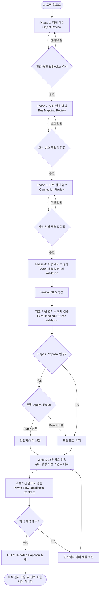

# 🔄 PowerLens 워크플로 정의서 (Workflow Definition)

> **문서 버전**: v2.0.0 (2026-09-27)  
> **문서 목적**: 제17회 전력산업 소프트웨어 경진대회·AI 경진대회 제출용 워크플로 정의 파일  
> **파이프라인 범위**: 도면 이미지 입력부터 AI 비전 추출, 4단계 Human-in-the-Loop 검수, 엑셀 교차 대조, CAD 편집, 준비도 진단, Full AC Newton-Raphson 조류계산까지의 전 주기

---

## 1. 전체 워크플로 흐름도 (End-to-End Workflow Diagram)

---

## 2. 단계별 상세 워크플로 명세 (Detailed Stage Specifications)

---

### Step 1. 도면 입력 및 객체 검수 (Phase 1: Object Review)

- **INPUT**:
  - 단선도 래스터 이미지 (`.png`, `.jpg`, `.jpeg`).
- **PROCESS**:
  1. 백엔드 `POST /review/detect_objects` 호출.
  2. YOLO11 모델(`2026_07_30_coslr.pt`)과 OpenCV 기하 검출기 앙상블 가동.
  3. 신뢰도, Bounding Box 크기, 중첩도(IoU)를 분석하여 객체를 정상(`DETECTED`)과 의심(`SUSPICIOUS`)으로 분류.
  4. 프론트엔드 검수 화면에 객체 목록 및 시각적 Bounding Box 오버레이 표출.
- **OUTPUT**:
  - `GraphDocument` 내 노드 목록 (`nodes`), 검수 세션 ID (`session_id`), 분류 상태 (`DETECTED` / `SUSPICIOUS`).
- **BLOCKER**:
  - 미승인 의심 객체(`SUSPICIOUS`)가 남아 있는 경우.
  - 심볼 분류(`class`)가 누락되었거나 Bounding Box 크기가 0 이하인 경우.
- **HUMAN ACTION**:
  - 의심 객체 바운딩 박스를 클릭하여 분류(모선, 발전기, 부하, 변압기)를 확인하거나 수정.
  - 오탐된 객체 삭제 또는 미탐된 객체 추가.
  - 정상 객체 일괄 승인 버튼([정상 객체 승인]) 클릭 후 다음 단계 이동 요청.

---

### Step 2. 모선 번호 매핑 (Phase 2: Bus Mapping Review)

- **INPUT**:
  - Phase 1에서 승인된 모선 객체 목록.
- **PROCESS**:
  1. Phase 2 진입 시 백엔드 `POST /review/link_bus_numbers` 자동 트리거.
  2. 각 모선 바운딩 박스 주변 국소 텍스트 영역을 크롭하고 시각적 태그(`B1`, `B2`...)를 부착한 Set-of-Mark 콜라주 생성.
  3. Google Gemini Vision API(`gemini-3.8-flash`, 폴백 `gemini-3.6-flash`)를 호출하여 모선 번호 OCR 판독.
  4. 중복 번호 및 비정상 번호 필터링 후 확실한 번호만 `VERIFIED`로 지정, 불확실 항목은 `UNCERTAIN`으로 보존.
  5. 검증된 번호를 직결된 발전기/부하/변압기 리드선에 자동 전파 (`propagate_bus_numbers_to_devices`).
- **OUTPUT**:
  - 각 모선 노드의 확정 번호 (`bus_number`), 장치의 소속 모선 (`connected_bus_number`).
- **BLOCKER**:
  - 모선 번호가 누락되었거나 양의 정수가 아닌 모선이 존재하는 경우.
  - 서로 다른 2개 이상의 모선이 동일한 모선 번호를 중복 보유한 경우.
  - `UNCERTAIN` 상태로 보존된 모선이 해소되지 않은 경우.
- **HUMAN ACTION**:
  - 화면 좌측 모선 목록에서 미인식 또는 불확실 모선을 선택하고 올바른 모선 번호(정수) 직접 입력.
  - 중복 번호 수정 후 [모선 번호 확정] 승인 클릭.

---

### Step 3. 선로 결선 검수 (Phase 3: Connection Review)

- **INPUT**:
  - 모선 및 설비 노드, 원본 도면 이미지.
- **PROCESS**:
  1. 백엔드 `POST /review/trace_connections` 호출.
  2. 설비 심볼 마스킹, 1픽셀 간극 보정, Zhang-Suen 골격화 및 8-연결 픽셀 경로 추적 가동.
  3. 선로를 송전선로(Branch), 변압기 가상 리드선(`is_transformer_lead: True`), 설비 인입선(`isEquipmentLead: True`)으로 분류.
  4. 다자 연결 또는 모호 결선(`AMBIGUOUS`) 진단.
- **OUTPUT**:
  - 선로 엣지 목록 (`edges`), 포트 연결 쌍 (`connected_to`), 픽셀 좌표 경로 (`path`).
- **BLOCKER**:
  - 양단이 모선에 정상 접속되지 않은 고립 모선(Isolated Bus) 존재.
  - 발전기가 어느 모선에도 접속되지 않은 단선 상태.
  - 양단 노드가 동일한 루프 선로(Self-loop).
- **HUMAN ACTION**:
  - 결선 오버레이 화면에서 모호 결선 선로를 확인.
  - 오결선된 선로의 종단 타깃을 올바른 모선으로 재할당.
  - 고립된 선로 수정 후 [선로 결선 승인] 클릭.

---

### Step 4. 최종 게이트 검증 (Phase 4: Deterministic Final Validation)

- **INPUT**:
  - Phase 1~3에서 승인된 노드 및 선로 데이터.
- **PROCESS**:
  1. 백엔드 `POST /review/verify_final_gate` 호출.
  2. 결정론적 규칙 검증기(`verify_final_gate`)가 전 계통 무결성 일괄 스캔:
     - 모든 모선의 양의 정수 고유 번호 부여 확인.
     - 모든 발전기/부하의 모선 번호 일치성 확인.
     - 모든 선로의 유효 endpoint(2개) 및 픽셀 경로(2점 이상) 확인.
  3. 무결성 만족 시 불변 `VerifiedSLD` JSON 객체 발행.
- **OUTPUT**:
  - `VerifiedSLD` (status: `VERIFIED`, nodes, lines).
- **BLOCKER**:
  - Phase 1~3의 잔존 이슈가 1건이라도 남아 있는 경우 (전 단계로 롤백 안내).
- **HUMAN ACTION**:
  - 최종 검수 요약 카드(모선 수, 발전기 수, 부하 수, 선로 수) 검토.
  - [검증 도면 확정] 버튼 클릭.

---

### Step 5. 엑셀 제원 연계 & 교차 검증 (Excel Binding & Cross Validation)

- **INPUT**:
  - `VerifiedSLD` JSON 데이터.
  - 전력 계통 제원 엑셀 파일 (`.xlsx` — BUS, BRANCH, GEN, LOAD, TRANS).
- **PROCESS**:
  1. 백엔드 `POST /apply_excel_to_elements` 호출.
  2. `ExcelCaseImporter`가 엑셀 시트 파싱 및 단위 정규화.
  3. `discrepancy_checker.py`가 도면 설비와 엑셀 설비를 교차 대조:
     - 모선 전압($V$), 위상각($\theta$), 발전/부하 용량($P, Q$), 선로 임피던스($R, X, B$), 변압기 탭비($a$) 결합.
     - 불일치 항목(`missing_in_canvas`, `missing_in_excel`) 식별.
  4. **수리 제안(Repair Proposal) 생성 규칙**:
     - `missing_in_canvas` 중 **발전기(Generator)** 및 **부하(Load)**에 대해서만 생성.
     - 모선, 선로, 변압기는 절대로 자동 생성하지 않음.
     - 도면 전용 설비는 자동 삭제하지 않고 불일치 검토 항목으로 유지.
- **OUTPUT**:
  - 바인딩된 설비 목록, 불일치 보고서(`mismatch_report`), 수리 제안(`repair_proposals`).
- **BLOCKER**:
  - 엑셀 내 슬랙 모선 미지정.
  - 도면 모선 번호와 엑셀 모선 번호 간 심각한 불일치로 해석 불능 상태.
- **HUMAN ACTION**:
  - 불일치 진단 모달(`ExcelMismatchDialog`)에서 차이점 검토.
  - 수리 제안에 대해 명시적으로 **[Apply (반영)]** 또는 **[Reject (거절)]** 선택:
    - **Apply**: 해당 발전기/부하를 도면의 해당 모선 위치에 추가.
    - **Reject**: 원본 도면 설비 유지.
  - [캔버스로 이동] 클릭.

---

### Step 6. Web CAD 캔버스 전송 및 배치 (CAD Canvas Transfer)

- **INPUT**:
  - 확정된 요소 목록 및 방향 메타데이터.
- **PROCESS**:
  1. `VerifiedSldCanvasMapper.map`이 호출되어 캔버스 중심(`CANVAS_CENTER = 3000.0`)으로 평행 이동.
  2. 부하(Load) 기호에 대해 부모 모선 상대 위치(`dx`, `dy`) 및 인출선 벡터를 기반으로 상·하·좌·우 4방향 스냅 회전 각도 자동 계산.
  3. 캔버스 화면 렌더링.
- **OUTPUT**:
  - Web CAD 캔버스 상의 인터랙티브 전력망 회로도.
- **BLOCKER**:
  - 없음 (자유 작도 및 편집 가능).
- **HUMAN ACTION**:
  - 마우스 드래그를 통한 심볼 위치 조정.
  - 키보드 방향키(`↑ / ↓ / ← / →`)로 1px 미세 정렬, `Shift + 방향키`로 10px 이동.
  - `Ctrl + R`로 부품 90도 회전.
  - 인스펙터 패널에서 개별 파라미터 확인 및 수정.

---

### Step 7. 조류계산 준비도 검증 (Power Flow Readiness Contract)

- **INPUT**:
  - 캔버스 내 모든 요소 (`elements`).
- **PROCESS**:
  1. `PowerFlowReadiness.check(elements)` 실행.
  2. 엄격한 기술 계약(Contract) 검증:
     - 슬랙 모선 지정 여부.
     - 유효 발전기 및 부하 존재 여부.
     - 임피던스 미입력(`MISSING`) 선로 부재.
     - 변압기 전기적 브랜치 유효성.
- **OUTPUT**:
  - `PowerFlowReadiness` 객체 (`canRun: true / false`, `missingRequirements` 목록).
- **BLOCKER**:
  - 필수 요구조건 미충족 시 `[조류계산 실행]` 버튼 비활성화.
- **HUMAN ACTION**:
  - 인스펙터에 표시된 미비 사항(예: 슬랙 모선 체크, 선로 임피던스 입력) 보완.

---

### Step 8. Full AC Newton-Raphson 조류계산 실행 (Power Flow Execution)

- **INPUT**:
  - 검증 완료된 `elements` 배열, 기준 용량(`s_base_mva = 100.0`).
- **PROCESS**:
  1. 백엔드 `POST /run_simulation` 호출.
  2. `PowerFlowSolver` 가동:
     - 변압기 인입선 및 기기 인입선 바이패스.
     - 복소 어드미턴스 행렬($Y_{\text{bus}}$) 및 야코비안 행렬($\mathbf{J}$) 형성 (Dense NumPy 2D 배열).
     - $\mathbf{J} \Delta \mathbf{x} = -\mathbf{F}(\mathbf{x})$ 반복 풀이.
     - 수렴 판정 ($\max(|\Delta P_i|, |\Delta Q_i|) \le 10^{-4}\,\text{pu}$).
- **OUTPUT**:
  - 조류계산 수렴 결과 JSON (모선별 $V, \theta, P, Q$, 선로별 유효/무효 조류, 손실, 수렴 반복 횟수).
- **BLOCKER**:
  - 비수렴(발산) 발생 시 경고 및 최대 오차 표출.
- **HUMAN ACTION**:
  - 결과 요약 확인.

---

### Step 9. 결과 표출 및 조류 흐름 벡터 가시화 (Results & Visualization)

- **INPUT**:
  - 수렴 완료된 시뮬레이션 결과 데이터.
- **PROCESS**:
  1. CAD 캔버스 송전선로 상에 유효전력($P$) 부호에 따른 정방향/역방향 화살표(➔) 벡터 애니메이션 가동.
  2. 각 선로 상단에 `Bus A ➔ Bus B: XX.X MW` 전력 조류 배지 표출.
  3. 모선 선택 시 전압 크기($V$), 위상각($\theta$), 발전/부하 현황 HUD 카드 표시.
- **OUTPUT**:
  - 직관적인 전력 계통 상태 가시화 화면 및 결과 엑셀 다운로드(`POST /download_result_excel`).
- **HUMAN ACTION**:
  - 과부하 선로 및 저전압 모선 파악, 결과 엑셀 파일 저장.
